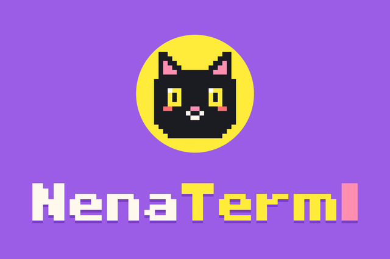
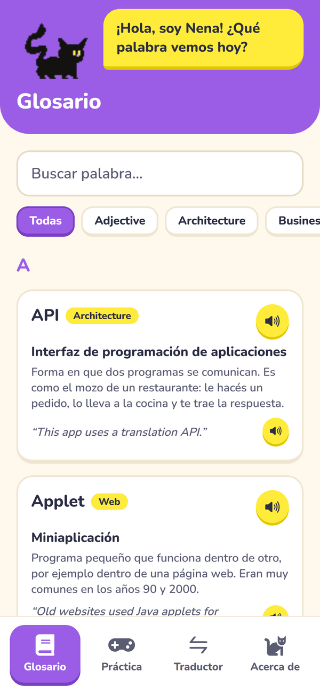
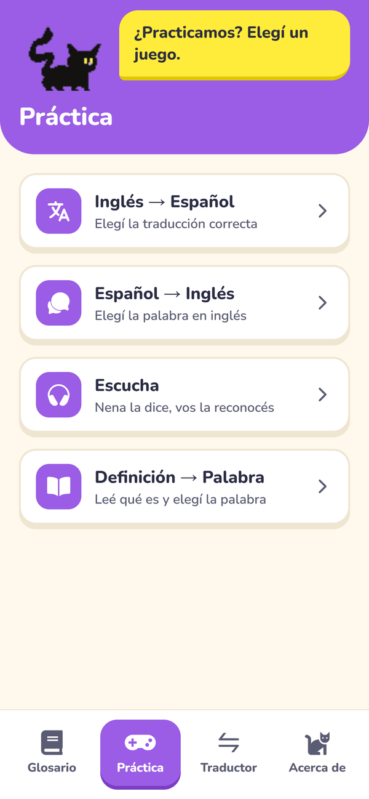
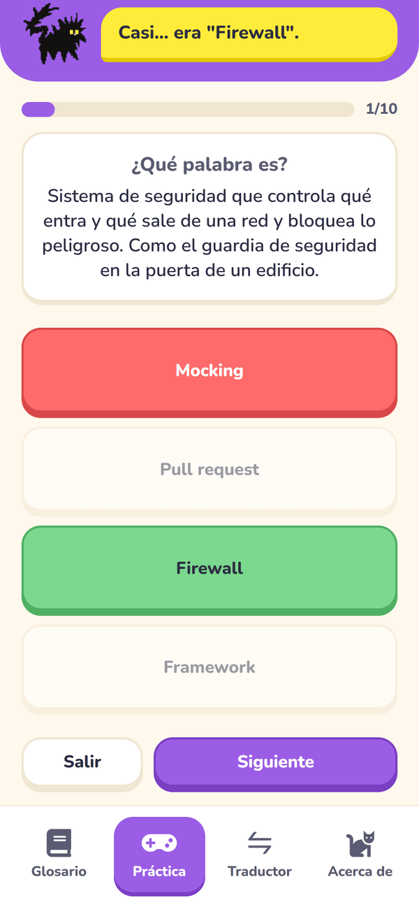
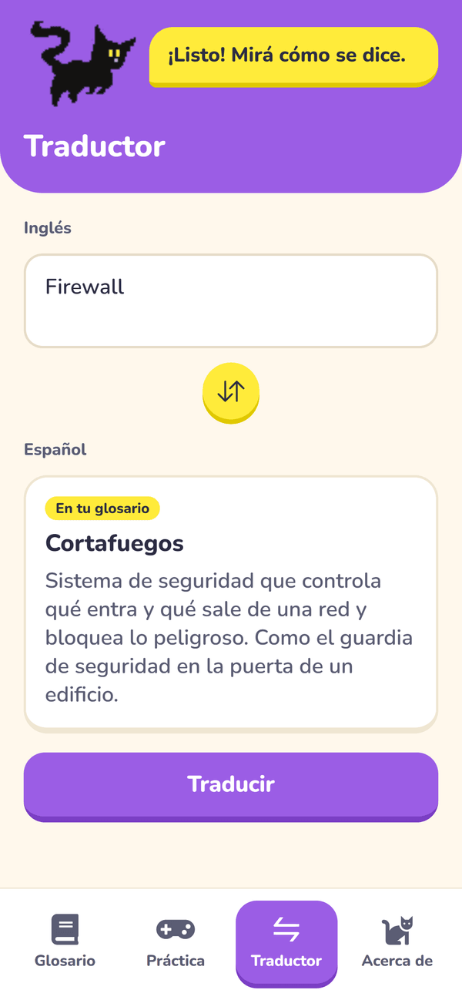

<p align="center">
  
</p>

**NenaTerm** es una app de celular (Android / iOS) con el glosario de palabras técnicas en inglés que fuimos anotando durante el año en **Inglés Técnico II**. Además de consultarlas, sirve para practicarlas y escucharlas, con la ayuda de **Nena**, una gatita que reacciona a lo que hacés.

<p align="center">
  
  
  
  
</p>

## Qué tiene

- **Glosario**: 67 palabras ordenadas de la A a la Z, con buscador (en inglés o en español) y filtro por categoría. Cada palabra tiene traducción, una definición pensada para alguien que no sabe de programación, un ejemplo de uso y botones para escuchar la palabra y el ejemplo en inglés.
- **Práctica**: cuatro minijuegos de 10 preguntas al azar:
  - *Inglés → Español*: elegir la traducción correcta.
  - *Español → Inglés*: elegir la palabra en inglés.
  - *Escucha*: Nena dice la palabra y hay que reconocerla.
  - *Definición → Palabra*: leer la definición y elegir la palabra.

  Al final se ve el puntaje y las palabras para repasar.
- **Traductor**: primero busca la palabra en el glosario. Si no está, la traduce con la API de MyMemory.
- **Acerca de**: créditos del proyecto.

Nena acompaña en todas las pantallas: salta cuando acertás, se golpea cuando errás, se marea si errás varias seguidas y gruñe si la tocás. Los juegos tienen sonidos y vibración, que respetan el modo silencio del celular.

## Instalarla en Android

La app se distribuye como un `.apk` generado con EAS (ver [Generar el APK](#generar-el-apk)). Para instalarlo, abrí el archivo desde el celular y aceptá instalar apps de esa fuente. Las actualizaciones llegan solas: se descargan al abrir la app y se aplican la próxima vez que se abre.

## Correrla en modo desarrollo

Hace falta [Node.js](https://nodejs.org) y la app **Expo Go** en el celular (la versión actual, que es la del SDK 58).

1. **Sprites de Nena.** No están en el repo porque su licencia no permite redistribuirlos. Descargá el *Cat Sprite Pack* de julesleech (está en itch.io) y copiá estos archivos a `assets/cat/`: `Sheet_Cat_Dizzy.png`, `Sheet_Cat_Hurt.png`, `Sheet_Cat_Jump.png`, `Sheet_Cat_Playing.png`, `Sheet_Cat_Run.png`, `Sheet_Cat_Sad.png`, `Sheet_Cat_Sat.png` y `Sheet_Cat_Sleep.png`.
2. **Instalar y arrancar:**

   ```bash
   npm install
   npx expo start
   ```

3. Escaneá el código QR con Expo Go (Android) o con la cámara (iOS). Si se queda trabada cargando, probá con:

   ```bash
   npx expo start --offline   # si la PC no tiene buena conexión a internet
   npx expo start --tunnel    # si el celular no llega a la PC por el Wi-Fi
   ```

En Expo Go no se ve la pantalla de inicio (splash) con el logo: aparece recién en el APK.

## Cómo agregar palabras

Las palabras están en [`src/data/data.ts`](src/data/data.ts). Cada una tiene esta forma:

```ts
{
  id: "bandwidth",
  word: "Bandwidth",
  translation: "Ancho de banda",
  definition: "Cantidad de datos que una conexión puede transportar por segundo.",
  example: "Video calls need a lot of bandwidth.",
  category: "Networking",
},
```

Las categorías nuevas aparecen solas en el filtro del glosario, y las palabras nuevas entran automáticamente en los minijuegos. Para que lleguen a los celulares que ya tienen la app, publicá una [actualización](#actualizar-la-app-sin-reinstalarla).

## Generar el APK

El APK se compila en la nube con [EAS](https://expo.dev/eas). Hace falta una cuenta de Expo:

```bash
npx eas-cli@latest login
npx eas-cli@latest build -p android --profile preview
```

Al terminar, EAS da un link para descargar el `.apk`. Cada build nuevo se instala encima del anterior sin perder nada.

Los sprites de Nena no están en el repo, pero el build los necesita: por eso [`.easignore`](.easignore) los incluye al subir el proyecto a EAS.

## Actualizar la app sin reinstalarla

Los cambios de código, palabras o sonidos se mandan a los celulares que ya tienen el APK:

```bash
npx eas-cli@latest update --channel preview --environment preview --message "qué cambió"
```

Si se agrega una librería con código nativo, o se cambia el ícono o la splash, la actualización ya no le llega al APK viejo y hay que generar uno nuevo.

## Tecnologías

- [Expo](https://expo.dev) (SDK 58) + React Native + TypeScript
- Expo Router para la navegación por pestañas
- `expo-speech` para la pronunciación, `expo-audio` para los sonidos y `expo-haptics` para la vibración
- EAS Build para generar el APK y EAS Update para las actualizaciones
- [MyMemory](https://mymemory.translated.net/) para las traducciones

## Estructura

```
src/
  app/          pantallas (cada archivo de app/(tabs) es una pestaña)
  components/   componentes reutilizables (tarjetas, botones, mascota, minijuegos)
  services/     lógica: búsqueda, quiz, traducción, voz, sonidos y vibración
  data/         las palabras del glosario
  mascot/       animaciones de Nena
  constants/    colores y estilos compartidos
assets/
  audio/        sonidos de los juegos y de Nena
  images/       ícono, logo de la splash y favicon
  cat/          sprites de Nena (no están en el repo)
docs/           imágenes de este README
```

## Créditos

- Mascota: *Cat Sprite Pack* por julesleech (itch.io)
- Interpretación de la mascota: Negrita “Nena” (mascota de Tiziana Oldoni)
- Sonidos: *Interface Sounds* por Kenney (kenney.nl, CC0)
- Traducción: MyMemory
- Tipografía: Nunito (Google Fonts)
